# AERVYN: ECHOES OF TIME
## DATABASE SCHEMA & OPTIMIZATION MANUAL

**Database Engine:** MySQL 8.0+ / MariaDB 10.5+  
**ORM:** Laravel 12 Eloquent  
**Charset / Collation:** `utf8mb4` / `utf8mb4_unicode_ci`  

---

## 1. Relational Schema Architecture

```mermaid
erDiagram
    users ||--o{ player_progress : "has world saves"
    users ||--o{ game_sessions : "has sessions"
    users ||--o{ player_achievements : "unlocks"
    users ||--o{ friendships : "friends with"
    users ||--o{ friend_requests : "sends/receives"
    users ||--o{ blocked_players : "blocks"
    users ||--o{ challenges : "creates/defends"
    users ||--o{ social_notifications : "receives"
    users ||--o| player_privacy_settings : "owns"
    users ||--o{ player_reports : "files/is reported in"
    users ||--o{ social_activities : "broadcasts"
    users ||--o{ feedback : "submits"
    users ||--o{ admin_activity_logs : "triggers"

    worlds ||--o{ missions : "contains"
    worlds ||--o{ collectibles : "contains"
    worlds ||--o{ player_progress : "tracked in"
```



---

## 2. Table Specifications

### 1. `users`
Core account table for players and studio administrators.
- `id` (BIGINT, PK, AUTO_INCREMENT)
- `name` (VARCHAR 255, UNIQUE) — Player username / callsign
- `display_name` (VARCHAR 255, NULLABLE)
- `email` (VARCHAR 255, UNIQUE)
- `password` (VARCHAR 255) — Bcrypt 12-round hash
- `role` (ENUM: `'player'`, `'admin'`) — Default `'player'`
- `avatar` (VARCHAR 255, NULLABLE)
- `bio` (TEXT, NULLABLE)
- `level` (INT) — Default 1
- `xp` (INT) — Default 0
- `is_active` (BOOLEAN) — Default 1
- `is_banned` (BOOLEAN) — Default 0
- `is_social_suspended` (BOOLEAN) — Default 0
- `social_suspended_reason` (VARCHAR 255, NULLABLE)
- `last_login_at` (TIMESTAMP, NULLABLE)
- `created_at`, `updated_at` (TIMESTAMP)

### 2. `player_progress`
Primary game progression and world checkpoint persistence.
- `id` (BIGINT, PK, AUTO_INCREMENT)
- `user_id` (BIGINT, FK -> `users.id`, CASCADE)
- `world_id` (VARCHAR 50) — `world_1`, `world_2`, `world_3`, `world_final`
- `current_mission` (VARCHAR 255)
- `current_step` (INT) — Milestones (1-10)
- `completed_objectives` (JSON)
- `inventory` (JSON)
- `checkpoint_id` (VARCHAR 255)
- `checkpoint_position` (JSON) — `{"x": 0, "y": 1, "z": 6}`
- `is_completed` (BOOLEAN) — Default 0
- `campaign_completed` (BOOLEAN) — Default 0
- `ending_selected` (VARCHAR 50, NULLABLE) — `ending_a`, `ending_b`
- `story_journal` (JSON) — Unlocked lore IDs
- `playtime_seconds` (INT) — Default 0
- **Index:** `UNIQUE (user_id, world_id)`

### 3. `game_sessions`
Telemetry session tracking for analytics and average completion times.
- `id` (BIGINT, PK, AUTO_INCREMENT)
- `user_id` (BIGINT, FK -> `users.id`, CASCADE)
- `world_id` (VARCHAR 50)
- `started_at` (TIMESTAMP)
- `ended_at` (TIMESTAMP, NULLABLE)
- `duration_seconds` (INT) — Default 0
- `xp_earned` (INT) — Default 0
- `completed` (BOOLEAN) — Default 0

### 4. `achievements` & `player_achievements`
Gamification badges and rewards.
- `achievements`: `id`, `code` (UNIQUE), `title`, `description`, `icon`, `xp_reward`, `world_id`
- `player_achievements`: `id`, `user_id` (FK), `achievement_id` (FK), `unlocked_at`, `INDEX UNIQUE (user_id, achievement_id)`

### 5. `friendships` & `friend_requests`
Bi-directional friend mesh.
- `friendships`: `id`, `user_id` (FK), `friend_id` (FK), `created_at`, `INDEX UNIQUE (user_id, friend_id)`
  *Stored symmetrically upon request acceptance to enable zero-overhead indexed `$user->friendships` queries.*
- `friend_requests`: `id`, `sender_id` (FK), `receiver_id` (FK), `status` (`'pending'`, `'accepted'`, `'rejected'`, `'cancelled'`), `responded_at`

### 6. `challenges`
Asynchronous multiplayer competition arena.
- `id` (BIGINT, PK, AUTO_INCREMENT)
- `challenger_id` (BIGINT, FK -> `users.id`, CASCADE)
- `opponent_id` (BIGINT, FK -> `users.id`, CASCADE)
- `challenge_type` (VARCHAR 100) — `courtyard_sprint`, `quantum_harvest`, etc.
- `title`, `description`, `target_metric`, `target_value`
- `status` (`'pending'`, `'accepted'`, `'rejected'`, `'active'`, `'completed'`, `'expired'`, `'cancelled'`)
- `challenger_score`, `challenger_time_seconds`, `challenger_completed_at`
- `opponent_score`, `opponent_time_seconds`, `opponent_completed_at`
- `winner_id` (BIGINT, FK -> `users.id`, NULLABLE)
- `xp_reward` (INT)
- `expires_at` (TIMESTAMP)

### 7. `player_privacy_settings`
Granular broadcast permissions.
- `user_id` (BIGINT, PK, FK -> `users.id`, CASCADE)
- `allow_friend_requests` (BOOLEAN, default 1)
- `show_public_profile` (BOOLEAN, default 1)
- `show_achievements` (BOOLEAN, default 1)
- `show_leaderboard_profile` (BOOLEAN, default 1)
- `show_selected_ending` (BOOLEAN, default 1)
- `show_challenge_statistics` (BOOLEAN, default 1)

### 8. `player_reports`
Staff moderation queue.
- `id` (BIGINT, PK, AUTO_INCREMENT)
- `reporter_id` (BIGINT, FK -> `users.id`, CASCADE)
- `reported_user_id` (BIGINT, FK -> `users.id`, CASCADE)
- `challenge_id` (BIGINT, FK -> `challenges.id`, NULLABLE)
- `category` (`'harassment'`, `'cheating'`, `'abuse'`, `'inappropriate_content'`, `'other'`)
- `reason` (TEXT)
- `status` (`'new'`, `'reviewing'`, `'resolved'`, `'rejected'`)
- `admin_notes` (TEXT, NULLABLE)
- `resolved_by` (BIGINT, FK -> `users.id`, NULLABLE)

### 9. `buyer_inquiries`
Commercial lead capture and B2B inquiry pipeline.
- `id` (BIGINT, PK, AUTO_INCREMENT)
- `name` (VARCHAR 255) — Prospect name
- `email` (VARCHAR 255) — Business email
- `company` (VARCHAR 255, NULLABLE) — Organization / studio
- `country` (VARCHAR 100, NULLABLE) — Geographic location
- `inquiry_type` (VARCHAR 100) — `game_purchase`, `b2b_licensing`, `customization`, `reskin`, `technical_inquiry`, `partnership`, `other`
- `message` (TEXT) — Buyer requirements / questions
- `status` (VARCHAR 50) — `new`, `contacted`, `qualified`, `closed` (default: `'new'`)
- `admin_notes` (TEXT, NULLABLE) — Internal CRM follow-up logs
- `ip_address` (VARCHAR 45, NULLABLE) — Rate-limiting audit telemetry
- `created_at`, `updated_at` (TIMESTAMP)

### 10. `game_settings`
Dynamic configuration, white-label branding, and feature flags.
- `key` (VARCHAR 191, PK) — Config key (e.g. `white_label_enabled`, `app_name`, `feature_social`)
- `value` (TEXT, NULLABLE) — Setting string or JSON value
- `description` (VARCHAR 255, NULLABLE)
- `category` (VARCHAR 50) — `branding`, `features`, `maintenance`, `general`, `gameplay`
- `created_at`, `updated_at` (TIMESTAMP)

---

## 3. Database Initialization & Buyer Setup
To create the database from scratch on a clean MySQL server:

```sql
-- 1. Create database with UTF8MB4 encoding
CREATE DATABASE aervyn_db CHARACTER SET utf8mb4 COLLATE utf8mb4_unicode_ci;

-- 2. Create isolated database user (replace password with secure value)
CREATE USER 'aervyn_user'@'localhost' IDENTIFIED BY 'YOUR_SECURE_PASSWORD';
GRANT ALL PRIVILEGES ON aervyn_db.* TO 'aervyn_user'@'localhost';
FLUSH PRIVILEGES;
```

Then execute the migrations and master seeders:
```bash
cd backend
php artisan migrate --force
php artisan db:seed --force
```

---

## 3. Query Optimization & Indexing

1. **Composite Unique Indexes:**
   - `player_progress(user_id, world_id)`: Guarantees exactly one active progression record per world per player.
   - `player_achievements(user_id, achievement_id)`: Prevents duplicate XP exploitation.
   - `friendships(user_id, friend_id)`: Fast $O(1)$ friend check without table scans.
2. **Eager Loading Enforcement:**
   - Leaderboards eager-load `with(['achievements', 'allProgress'])`.
   - Admin reports eager-load `with(['reporter', 'reportedUser', 'challenge', 'resolver'])`.
   - Social notifications eager-load target resources.
3. **Foreign Key Cascades:**
   - Deleting test accounts cleanly cascades across progress, sessions, notifications, and privacy settings without leaving orphan rows.
