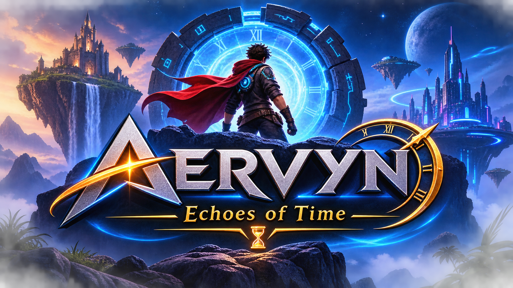

<div align="center">
  

  # AERVYN: ECHOES OF TIME
  ### Official Commercial 3D Adventure & Time Travel Game Product

  **Version 1.0.0 — Commercial Master Release**

  [-brightgreen.svg)]()
  [-cyan.svg)]()
  []()
  []()
  []()
  []()
</div>

---

## 1. Product Overview

**AERVYN: ECHOES OF TIME** is an original, commercially sellable 3D adventure game combining deep atmospheric exploration, environmental puzzle solving, time-travel mechanics, and multi-timeline narrative progression.

Built on a unified **React 19 + Three.js (React Three Fiber) + Laravel 12** architecture, *AERVYN* delivers a complete, cohesive commercial package containing:
- A public **Commercial Showcase & Landing Page** (`/`) featuring 4-world previews, features grid, deliverables inventory, system requirements, and an interactive commercial inquiry form.
- An isolated **Buyer Demo Mode** (`/demo`) and **Demo Completion Screen** (`/demo/complete`) allowing prospective buyers to evaluate gameplay responsiveness, mechanics, and WebGL rendering in under 3 minutes without polluting production player databases.
- A controlled **White-Label & Reskin Architecture** with dedicated Admin UI (`/admin/branding`) supporting buyer branding, logo/favicon uploads, CSS theme colors, and safe reset to default AERVYN identity.
- A fully playable **Single-Player Story Campaign** spanning 4 distinct temporal worlds and Dual Narrative Endings that functions independently offline from a gameplay flow perspective.
- A premium **Player Gaming Dashboard** with level progression, XP gauges, achievements, inventory tracking, and personal lore journals.
- An optional **Asynchronous Social Layer** with player search, friends rosters, operative blocking, activity feeds, and verifiable challenge duels.
- An enterprise **23-Module Administrative Suite** with real-time studio KPIs, player management, world content editing, feedback triage, social moderation, and buyer inquiry CRM triage.

---

## 2. Technology Stack

### Frontend & 3D Game Engine (`frontend/`)
- **Core Framework:** React 19 (`react`, `react-dom`)
- **Build Tool:** Vite 8.x (Hot Module Replacement, ultra-fast production bundling)
- **3D Graphics Engine:** Three.js (R187) via React Three Fiber (`@react-three/fiber`) & Drei (`@react-three/drei`)
- **Animation & Transitions:** GSAP 3.x (GreenSock Animation Platform)
- **Audio Synthesis:** Real-time Web Audio API procedural sound engine (zero external `.mp3` dependencies)
- **Routing:** React Router DOM 7.x
- **Icons & Controls:** Lucide React

### Backend & API Architecture (`backend/`)
- **Framework:** Laravel 12.x
- **Runtime:** PHP 8.2+
- **Database:** MySQL 8.0+ / MariaDB (18 normalized InnoDB tables)
- **API Security:** Laravel Sanctum Bearer token authentication
- **Rate Limiting:** Throttle middleware protecting public authentication and API endpoints
- **Testing:** PHPUnit 11.5+ automated test suite

---

## 3. Story Campaign & The Four Worlds

```text
PROLOGUE: The Mystery of the First Timeline
   │
   ▼
WORLD 1: THE LOST KINGDOM (Antiquity)
• Ancient Romanesque castle courtyard, stone arches, runic pedestals
• Traversal onboarding: Walk, sprint, jump, inspect
• Collect 3 Temporal Energy Fragments -> Solve Ancient Gate Rune Puzzle -> Activate Portal
   │
   ▼
WORLD 2: THE BROKEN PRESENT (Dystopian Cyber City)
• Shattered rainy metropolis, collapsing skyscrapers, neon anomalies
• Access highway terminal -> Activate communications relay station
• Harvest 3 Quantum Energy Cores -> Breach underground lab -> Repair Central Time Core
   │
   ▼
WORLD 3: THE FRACTURED FUTURE (The End of Time)
• Floating sky islands drifting over cosmic void under celestial nebulae
• Cross gravitational Phase Bridge -> Recover 3 Chrono Shards
• Solve the 3 Time Labyrinth resonator switches (Alpha, Beta, Gamma)
• BOSS ENCOUNTER: Defeat THE CHRONARCH in the Timeline Engine Arena
   │
   ▼
WORLD 4: THE LAST TIMELINE (The Zero Horizon)
• Transcendent celestial platform at the Nexus of Creation
• Continuum Synchronization: Align 3 Epoch Keystones (Antiquity, Quantum, Singularity)
• HARMONIZATION DECISION:
    ├── ENDING A: The Prime Timeline Weaver (Stitch history into one unified continuum)
    └── ENDING B: The Shattered Continuum (Preserve reality as infinite multiverse branches)
```

---

## 4. Key Systems & Features

### Responsive Third-Person Traversal & Dynamic Camera
- **Desktop Controls:** WASD movement, Spacebar jump, Shift sprint, Mouse look orbit camera with pitch clamping.
- **Mobile Controls:** Dynamic on-screen virtual joystick, dedicated touch sprint toggle, jump button, proximity interaction prompt, and touch swipe camera rotation.
- **Viewport Scaling:** Tested and fully responsive from 360px mobile viewports up to 1920x1080 desktop displays without horizontal overflow.

### Graphics Quality Presets (`useGraphicsSettings.js`)
- **High:** Full shadows (2048x2048 shadow map), 3,500 celestial stars, antialiasing on, dynamic pixel ratio [1, 2].
- **Medium:** Optimized shadows (1024x1024 map), 2,200 stars, antialiasing on, DPR 1.0.
- **Low:** Shadows disabled for maximum frame rate, 1,000 stars, fast shader pipeline, DPR 0.8.
- *Preferences automatically persist to `localStorage`.*

### Asynchronous Player Challenges & Social Layer
- **Async Multiplayer Trials:**
  - `courtyard_sprint` (World 1 Time Trial — lower time is better)
  - `quantum_harvest` (World 2 Core Harvest — higher score is better)
  - `phase_bridge_reflex` (World 3 Reflex Score — higher score is better)
  - `chrono_rift_trial` (World 4 Survival Trial — higher score is better)
- **Anti-Cheat Validation:** All submissions verified against physical lower bounds; server determines winners and awards XP. Clients cannot inject arbitrary XP.
- **Granular Privacy:** 6 independent switches (`allow_friend_requests`, `show_public_profile`, `show_achievements`, `show_leaderboard_profile`, `show_selected_ending`, `show_challenge_statistics`).

### Administrative Management Suite (`/admin/*`)
- **13 Specialized Panels:** Overview KPIs, Players, Worlds, Missions, Collectibles, Analytics, Sessions, Feedback Triage, Admin Users, Activity Audit Logs, System Settings, Media Asset Library, and Social Conduct Moderation.
- **Protected Assets:** Permanent write protection prevents accidental deletion of the official brand logo.

---

## 5. Quick Start & Local Development

### Prerequisites
- Node.js 18+ LTS & npm
- PHP 8.2+ with `pdo_mysql`, `mbstring`, `xml`, `curl` extensions
- Composer
- MySQL 8.0+

### 1. Backend Setup
```bash
cd backend

# Install dependencies
composer install

# Configure environment
cp .env.example .env
# Update DB credentials in .env

# Run database migrations and seed master records
php artisan migrate
php artisan db:seed --class=AchievementSeeder

# Start local backend server
php artisan serve
# Server runs at http://127.0.0.1:8000
```

### 2. Frontend Setup
```bash
cd frontend

# Install dependencies
npm install

# Configure environment
cp .env.example .env

# Start local dev server
npm run dev
# Web application opens at http://localhost:5173
```

### 3. Default Demo Accounts
- **Player Account:** `player@aervyn.local` / `password123`
- **Admin Account:** `admin@aervyn.local` / `admin12345`

---

## 6. Verification & Quality Assurance

### Automated Backend Test Suite
```bash
cd backend
php artisan test
```
**Results:** **59 of 59 Passed (1,161 Assertions)** in ~32s:
- `BrandingAndFeatureFlagsTest.php`: Public branding default protection, white-label activation, color customization, and reset-to-default verification.
- `BuyerInquiryTest.php`: Public lead submission, rate limiting, and administrative CRM triage.
- `UserJourneyE2ETest.php`: Complete End-to-End User Journey (Ending A, Ending B, checkpoint resume, anti-cheat validation).
- `SocialApiTest.php`: Friends, requests, blocking, challenge arena, notifications, privacy, reports, admin moderation.
- `AdminApiTest.php`: 12 comprehensive administrative permission, CRUD, and telemetry tests.
- `GameApiTest.php`: Engine state, checkpoint saving, world completions, campaign summaries.
- `PlayerPortalApiTest.php`: Dashboard, profile update mass-assignment protection, achievements, leaderboards.

### Frontend Production Build
```bash
cd frontend
npm run build
```
**Results:** **0 Errors, 0 Warnings** (2,890 modules transformed in 1.28s).

---

## 7. Master Documentation Suite

Comprehensive technical, design, commercial, and operational manuals are available in the [`DOCUMENTATION/`](DOCUMENTATION/) directory:

- [README.md](DOCUMENTATION/README.md) — Master documentation index
- [COMMERCIAL_HANDOVER.md](DOCUMENTATION/COMMERCIAL_HANDOVER.md) — Technical transfer & handover manual
- [BUYER_HANDOVER_CHECKLIST.md](DOCUMENTATION/BUYER_HANDOVER_CHECKLIST.md) — Handover acceptance checklist
- [PRODUCT_OVERVIEW.md](DOCUMENTATION/PRODUCT_OVERVIEW.md) — Executive commercial summary & licensing scope
- [BUYER_FEATURE_LIST.md](DOCUMENTATION/BUYER_FEATURE_LIST.md) — Detailed feature inventory & deliverables
- [DEMO_GUIDE.md](DOCUMENTATION/DEMO_GUIDE.md) — Buyer demo evaluation guide
- [INSTALLATION_GUIDE.md](DOCUMENTATION/INSTALLATION_GUIDE.md) — Windows & Linux installation from zero
- [PRODUCTION_DEPLOYMENT_GUIDE.md](DOCUMENTATION/PRODUCTION_DEPLOYMENT_GUIDE.md) — Nginx, SSL, optimization, and security hardening
- [BACKUP_RESTORE_GUIDE.md](DOCUMENTATION/BACKUP_RESTORE_GUIDE.md) — Database & media backup and disaster recovery
- [MAINTENANCE_GUIDE.md](DOCUMENTATION/MAINTENANCE_GUIDE.md) — Routine maintenance, dependency updates, and rollback
- [TROUBLESHOOTING.md](DOCUMENTATION/TROUBLESHOOTING.md) — Diagnostics and solutions for common operational issues
- [INSTALLATION_VERIFICATION.md](DOCUMENTATION/INSTALLATION_VERIFICATION.md) — 22-point post-install verification protocol
- [RELEASE_MANIFEST.md](DOCUMENTATION/RELEASE_MANIFEST.md) — Product manifest & software bill of materials
- [SYSTEM_REQUIREMENTS.md](DOCUMENTATION/SYSTEM_REQUIREMENTS.md) — Minimum vs. recommended hardware specifications
- [THIRD_PARTY_DEPENDENCIES.md](DOCUMENTATION/THIRD_PARTY_DEPENDENCIES.md) — Inventory of all Composer & npm packages
- [LICENSE_INFO.md](DOCUMENTATION/LICENSE_INFO.md) — Commercial rights & legal clearance notice
- [TESTING_REPORT.md](DOCUMENTATION/TESTING_REPORT.md) — Quality assurance test execution report
- [CHANGELOG.md](DOCUMENTATION/CHANGELOG.md) — Chronological release history for Version 1.0.0
- [GAME_DESIGN_DOCUMENT.md](DOCUMENTATION/GAME_DESIGN_DOCUMENT.md) — Narrative, mechanics, and puzzle GDD
- [TECHNICAL_DOCUMENTATION.md](DOCUMENTATION/TECHNICAL_DOCUMENTATION.md) — Three.js architecture & Web Audio manual
- [API_DOCUMENTATION.md](DOCUMENTATION/API_DOCUMENTATION.md) — REST API specification with schemas
- [DATABASE_DOCUMENTATION.md](DOCUMENTATION/DATABASE_DOCUMENTATION.md) — ER diagram & 14 normalized tables
- [ADMIN_GUIDE.md](DOCUMENTATION/ADMIN_GUIDE.md) — Studio administrator portal manual
- [PLAYER_GUIDE.md](DOCUMENTATION/PLAYER_GUIDE.md) — Operative field manual & controls walkthrough

---

## 8. Commercial Clearance & Copyright

- **Asset IP Audit:** 100% of 3D geometry is procedurally generated code; 100% of sound effects and ambient soundtracks are procedurally synthesized via the Web Audio API. Zero external unlicensed 3D models or audio samples are bundled.
- **Dependencies:** All bundled software libraries (Three.js, React, Drei, GSAP, Laravel, Sanctum, Lucide React, Axios) are governed by permissive open-source licenses (MIT/ISC) permitting commercial distribution.
- **Official Brand Assets:** The name *AERVYN: ECHOES OF TIME* and the official brand logo (`frontend/public/assets/aervyn-logo.png`) are proprietary assets.

```text
STATUS: 100% PRODUCTION READY FOR COMMERCIAL RELEASE
VERSION: 1.0.0
```
